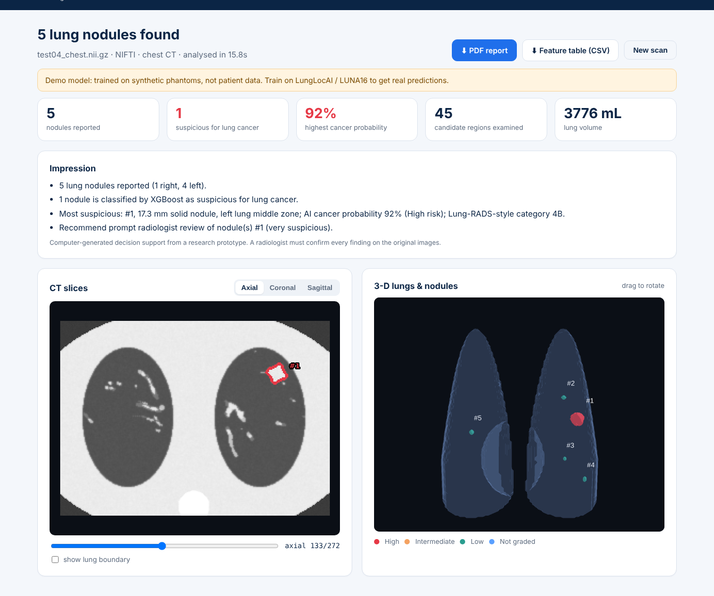
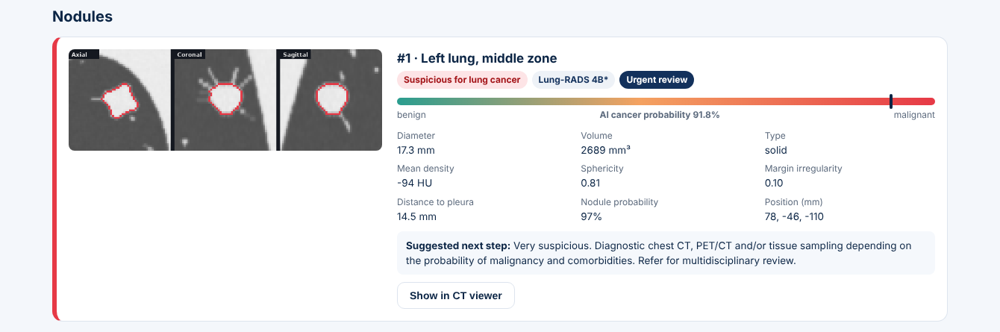

# LungLocAI: CT lung nodule detection and lung-cancer risk

**Upload a CT scan → the lungs are extracted (even from full-body CT) → nodules are found in 3-D →
each nodule becomes a row of measurements → XGBoost estimates whether it is a lung-cancer nodule →
a report a doctor can act on.**

🌐 **Live demo: https://lunglocai.gentlerock-8c108a22.eastasia.azurecontainerapps.io** (first load after idle ~30–60 s) &nbsp;·&nbsp; 🧪 **Test scans:** [Releases](../../releases) &nbsp;·&nbsp; 📓 **Train on LUNA16:** [`notebooks/`](notebooks)

> ⚠️ Research prototype for decision support. **Not a medical device.** A radiologist must confirm every finding.
> Do not upload scans that contain patient names or IDs.

<p align="center"></p>

## What it does

| Step | What happens | Code |
|---|---|---|
| 1. 3-D volume | CT resampled to 1 mm isotropic voxels in Hounsfield units | `app/pipeline/ct_io.py` |
| 2. Lung extraction | Finds the body and internal air, picks the two lungs (rejects bowel gas and outside air), crops them out of a full-body scan, labels left/right | `app/pipeline/lungs.py` |
| 3. Nodule detection | Multi-scale 3-D ball opening (1, 2, 3, 5 mm) separates round nodules from vessels; shape and pleura filters | `app/pipeline/nodules.py` |
| 4. Feature table | 33 numbers per nodule: size, 3-D shape, density, margin, location → CSV | `app/pipeline/features.py` |
| 5. XGBoost | `nodule_model` (real nodule vs. false positive) + `malignancy_model` (lung cancer vs. benign) | `app/pipeline/classifier.py` |
| 6. Report | AI cancer probability, Lung-RADS-v2022-style size category, follow-up suggestion, triage priority, 3-plane close-ups, slice viewer, 3-D view, **PDF** | `app/report.py` |

<p align="center"></p>

**Accepted uploads:** DICOM series (`.zip` of `.dcm` files, the hospital format), NIfTI (`.nii` / `.nii.gz`),
LUNA16 / MetaImage (`.mhd` **and** `.raw` together), NRRD. Chest CT and full-body CT both work.
A photo or screenshot of a CT (JPG/PNG) can't be analysed: it has no 3-D data or density values.

## Run it on your computer

**Windows:** double-click `run.bat` (installs everything on first run, then opens http://localhost:8000).
**macOS / Linux:** `./run.sh`

```bash
# or by hand
pip install -r requirements.txt
uvicorn app.main:app --port 8000
```

**Docker:**
```bash
docker build -t lunglocai .
docker run -p 7860:7860 lunglocai     # http://localhost:7860
```

## Put it online for everyone (Azure for Students, free)

The site needs a Python server (GitHub Pages can't run it). It runs on **Azure Container Apps**:
2 vCPU / 4 GB, scales to zero when idle, so normal use stays inside the monthly free grant
(180,000 vCPU-seconds + 360,000 GiB-seconds); Azure for Students adds $100 credit with no credit card.

Every push to `main` builds the Docker image with GitHub Actions and publishes it free at
`ghcr.io/nowfal1n/lunglocai` ([workflow](.github/workflows/azure.yml)).

**One-time setup (about 10 minutes):**
1. Activate **Azure for Students** with your college email: https://azure.microsoft.com/free/students
2. Open **Azure Cloud Shell**: https://shell.azure.com → choose **Bash** (if asked about storage, pick *No storage account required*).
3. Paste and press Enter:
   ```bash
   curl -sL https://raw.githubusercontent.com/NowfaL1N/LungLocAI/main/azure/setup.sh | bash
   ```
   It creates the app and prints the public link, e.g. `https://lunglocai.<random>.eastasia.azurecontainerapps.io`.
   (Azure for Students may block Indian regions; the script then tries the next allowed region automatically.)
4. *(Optional, enables auto-update on every push.)* If the script printed a JSON block, save it as a GitHub
   secret named `AZURE_CREDENTIALS` (Settings → Secrets and variables → Actions → New repository secret).
   Otherwise, update the live site after a push with
   `curl -sL https://raw.githubusercontent.com/NowfaL1N/LungLocAI/main/azure/update.sh | bash`.

To remove everything from Azure: `curl -sL https://raw.githubusercontent.com/NowfaL1N/LungLocAI/main/azure/delete.sh | bash`.

Uploaded scans and results are deleted automatically after 2 hours (`JOB_TTL_HOURS`), uploads are capped at
1.5 GB (`MAX_UPLOAD_MB`), and only one instance runs (`--max-replicas 1`) so each job stays on the
machine that processes it. After a period without visitors the first request takes ~30–60 s while the
container starts.

**Other hosts:** the same `Dockerfile` runs on Google Cloud Run, Oracle Cloud, any VPS
(`docker run -p 7860:7860 ghcr.io/nowfal1n/lunglocai`) or Hugging Face Spaces (Docker Spaces need a
PRO plan; set the `HF_TOKEN` secret and `HF_SPACE` variable to use [this workflow](.github/workflows/deploy-huggingface.yml)).
Give it at least 4 GB RAM, because full-body scans need it.

## Models: from demo to your LungLocAI dataset

The repo ships **DEMO models trained on synthetic phantoms**. The site and PDF say so in orange.
Train real ones on LUNA16 with the **same pipeline** so training and website features match exactly:

```bash
python training/build_luna16_table.py --luna-dir /path/LUNA16 --annotations /path/LUNA16/annotations.csv \
       --out data/lunglocai_table.csv --workers 2
python training/train_xgboost.py --table data/lunglocai_table.csv --task nodule
```
In Colab use [`notebooks/LungLocAI_train_on_LUNA16.ipynb`](notebooks/LungLocAI_train_on_LUNA16.ipynb) (resumable).
Put the resulting `models/*_model.json` + `.meta.json` in `models/` and commit; the next image build carries them to the live site.

**LUNA16 has no cancer labels.** Its annotations mark nodule vs. non-nodule. For the lung-cancer model,
take malignancy ratings from LIDC-IDRI:
```bash
pip install pylidc
python training/make_lidc_malignancy_csv.py --luna-dir /path/LUNA16 --out data/lidc_malignancy.csv
python training/build_luna16_table.py ... --malignancy data/lidc_malignancy.csv
python training/train_xgboost.py --table data/lunglocai_table.csv --task malignancy
```
Validation is grouped by scan (GroupKFold on `seriesuid`). AUC, sensitivity, specificity, the threshold
and the top features are stored in `.meta.json` and shown on the site and in the PDF.

## Measuring accuracy

`tools/evaluate.py` scores the whole pipeline (detection + XGBoost) against an answer key.
It works on the synthetic test set and on real LUNA16 scans:

```bash
python tools/evaluate.py --scans test_scans --annotations test_scans/annotations.csv
python tools/evaluate.py --scans /path/LUNA16/subset9 --annotations /path/LUNA16/annotations.csv
```

Results on the 7 synthetic test scans in [Releases](../../releases) (30 nodules, never used in training):

| Detection | | Lung-cancer classification | |
|---|---|---|---|
| Nodules found | 29 / 30 (96.7 %) | Cancers flagged | 10 / 11 (90.9 %) |
| False positives / scan | 0.71 | Benign wrongly flagged | 0 / 19 |
| Size error | 0.8 mm | AUC | 0.99 |

These numbers show the pipeline works. They are **not** clinical accuracy: run the same script on held-out
LUNA16 scans for that.

Rebuild the exact test set locally with `python tools/make_test_set.py --out test_scans`, or make new synthetic scans with `python tools/make_synthetic_ct.py --out data/synthetic --n 5 [--full-body]`.

## API

| Method | Path | |
|---|---|---|
| POST | `/api/analyze` | multipart `files` → `{job_id}` |
| GET | `/api/jobs/{id}` | status / result JSON |
| GET | `/api/jobs/{id}/report.pdf` | doctor report |
| GET | `/api/jobs/{id}/table.csv` | feature table + predictions |
| GET | `/api/jobs/{id}/slice?axis=axial&index=120` | PNG slice with nodule outlines |
| GET | `/api/jobs/{id}/scene` | 3-D meshes (lungs + nodules) |
| GET | `/api/model` | loaded models + metrics |

## Project layout

```
app/            FastAPI server, CT pipeline, report, web UI (static/)
models/         XGBoost models (*.json) + metadata (*.meta.json)
training/       build LUNA16 table, train XGBoost, LIDC malignancy export
tools/          synthetic CT generator, accuracy evaluation
notebooks/      Colab notebook for training on LUNA16
Dockerfile      container image (Azure Container Apps / any Docker host)
azure/          one-command Azure setup, update and delete scripts
```

## Known limitations

* A nodule fused with the mediastinum, heart or diaphragm can fall outside the lung mask and be missed.
* Faint ground-glass nodules (below −600 HU) and the faint rim of part-solid nodules can be under-segmented.
* Spiculations thinner than ~2 mm are removed by the morphological opening, so diameter can be under-estimated.
* The Lung-RADS category is an automatic approximation, not a radiologist's reading.
* The demo models are trained on synthetic data. Replace them before drawing any conclusions.

## License

MIT, see [LICENSE](LICENSE). Research use only; not for clinical diagnosis.
